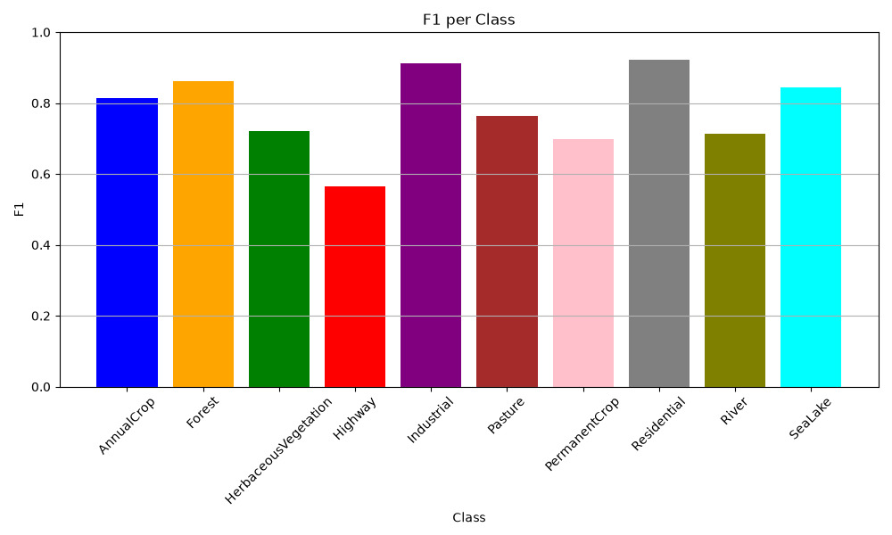
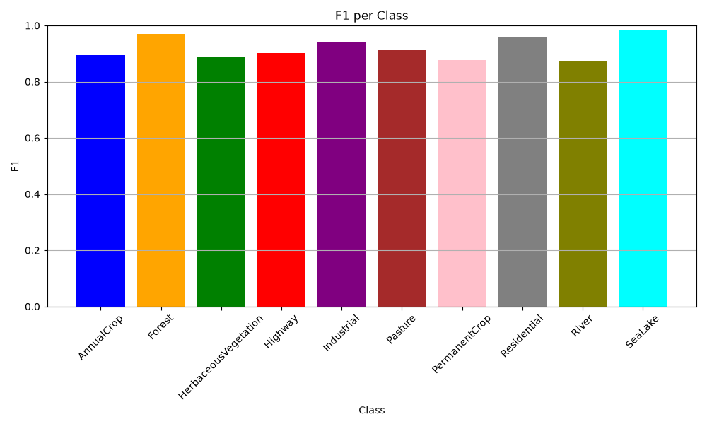
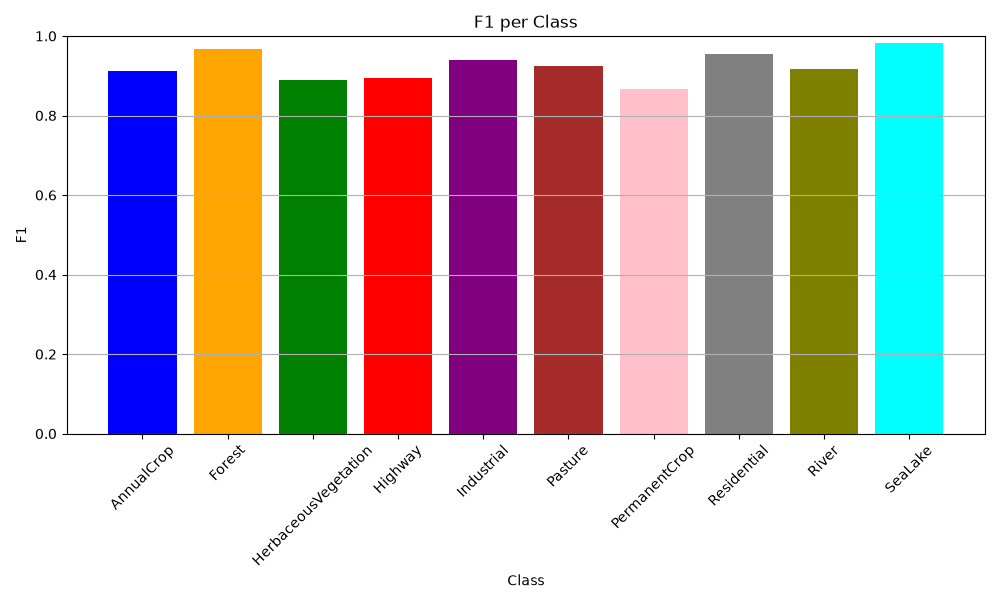
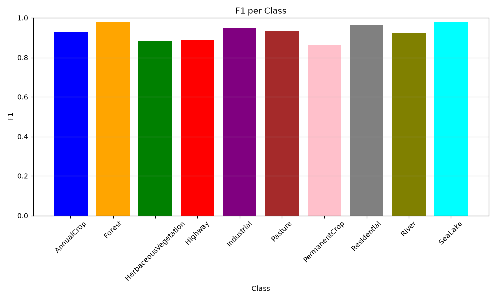

## EuroSatCNN
- EuroSatCNN is a simple Convolutional Neural Network based image classifier implemented in PyTorch.
- It is trained on the EuroSAT dataset of different terrain types.

# Results

### Iteration 0:
- Initial implementation.
- Total of 2 convolutional layers.
- Results:
  - Precision: 78%
  - Recall: 78%
  - Accuracy: 65%

### Iteration 1:
- Added a third convolutional layer.
- Big improvement.
- Results:
  - Precision: 92%
  - Recall: 92%
  - Accuracy: 85%

### Iteration 4:
- Update all ReLU activation functions to LeakyReLU.
- Minor improvement.
- Results:
  - Precision: 92.62%
  - Recall: 92.62%
  - Accuracy: 86.25%

### Iteration 6:
- Added a fourth convolutional layer.
- Minor improvement.
- Results:
  - Precision: 93.04%
  - Recall: 93.04%
  - Accuracy: 86.98%

